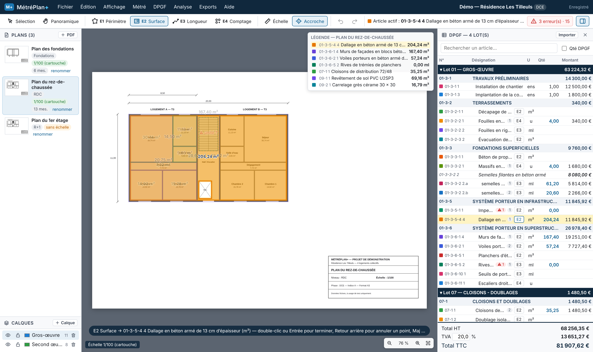

# MétréPlan+

Application web de **métré sur plans PDF** pour économistes de la construction, entièrement en français.
Sa particularité : le métré est **piloté par la DPGF** et **contrôlé par rapport au CCTP**.



## Démarrage rapide

Prérequis : **Node.js 22.13 ou plus récent** (la base SQLite utilise le module natif `node:sqlite`, aucune compilation n’est nécessaire).

```bash
npm install
npm run dev          # API sur http://localhost:3001 + interface sur http://localhost:5173
```

Au premier lancement, un **projet de démonstration** est créé : « Résidence Les Tilleuls », 4 logements collectifs
(plans des fondations, du RDC et du R+1 au 1/100, CCTP gros-œuvre, DPGF de 4 lots, mesures déjà saisies,
dont deux erreurs volontaires pour illustrer l’analyse de cohérence). Le bouton « Réinitialiser la démo » le recrée.

Production : `npm run build` puis `npm start` (l’interface est servie par l’API sur le port 3001).
Les données sont stockées dans `data/` (base `metreplan.sqlite` et fichiers importés) ; modifiable avec `METREPLAN_DATA`.

## Fonctions

| Domaine | Contenu |
| --- | --- |
| Projets | Création, ouverture, suppression ; nom, adresse, phase (ESQ à EXE) ; enregistrement automatique en base SQLite |
| Plans | Import de PDF multipages, une page = un plan nommé avec son niveau, vignettes ; nom et niveau devinés depuis le texte de la page |
| Échelle | Par cote connue (deux clics + longueur réelle), par échelle normalisée (1/50, 1/100…), ou détection automatique de « Échelle 1/xx » dans le cartouche |
| Outils | E1 Périmètre, E2 Surface avec trous / trémies déduits, E3 Longueur, E4 Comptage ; zoom molette, panoramique, accrochage aux extrémités des tracés du PDF et des mesures, mode orthogonal (Maj), annuler / rétablir, déplacement des sommets |
| Pilotage DPGF | Toute mesure est rattachée à un article ; **l’unité de l’article décide du calcul** (ml, m², m³, u) et l’outil conseillé est proposé ; paramètres hauteur, épaisseur, coefficient, % de chute, quantité par objet, par mesure ou par défaut pour l’article |
| Panneau DPGF | Quantité métrée, quantité de la DPGF importée, PU modifiable, montant, sous-totaux par chapitre et par lot, total HT / TVA / TTC mis à jour à chaque clic |
| Interface | Icônes dédiées pour chaque commande (barre d’outils, menus, panneaux) ; panneau DPGF redimensionnable à la souris (largeur mémorisée) et repliable pour agrandir la zone plan |
| Calques et légende | Création, affichage / masquage, verrouillage, couleur ; **couleur des mesures par article, par outil ou par calque** ; symbole des objets comptés au choix par article (cercle, carré, triangle, losange, croix) ; légende automatique sur le plan, adaptée au mode de couleur ; couleur de fond réglable |
| CCTP | Import PDF, extraction du texte, découpage en lot / chapitres / articles (en-têtes, pieds de page et sommaire ignorés), localisation, unité proposée |
| DPGF | Import Excel (.xlsx) multi-lots (une feuille par lot), titres, groupes et sous-lignes, quantités, PU, taux de TVA ; ou **génération d’une DPGF vierge depuis le CCTP** |
| Cohérence | Articles du CCTP absents de la DPGF, numérotation ou intitulés divergents, articles de DPGF non décrits au CCTP, articles sans mesure, mesures à l’unité incohérente (ex. m² mesuré à l’outil longueur), écarts métré / DPGF au-delà d’un seuil en %, pages mesurées sans échelle |
| Traçabilité | Clic sur une ligne de DPGF : ses mesures sont surlignées et le plan correspondant s’ouvre ; clic sur une mesure : son article est sélectionné ; chaque mesure garde page, niveau, calque, outil, paramètres et date |

| Tableau de bord | Montants HT / TTC, avancement du métré par lot, surfaces **SHO, SP, SH** par niveau et par pièce (surfaces E2 classées dans l’inspecteur), coût HT au m² SP et au m² SH, ratio SH / SP, quantités clés et € HT par m² SP |
| Export Excel | Classeur à 4 onglets : **DPGF quantifiée et chiffrée** (montants, sous-totaux et HT / TVA / TTC en formules Excel), **détail des mesures avec leur origine** (plan, niveau, calque, outil, paramètres, calcul, date), **tableau de bord**, **cohérence** |
| Export PDF | **Rapport de quantités par lot** avec récapitulatif, **tableau de bord et ratios**, **plans annotés** : les mesures sont dessinées sur la page PDF d’origine, avec une légende et les quantités |

## Raccourcis

`V` sélection · `H` ou Espace panoramique · `1`–`4` outils E1–E4 · `K` échelle par cote · `S` accrochage · `Maj` orthogonal ·
`Entrée` / double-clic terminer · `Retour arrière` retirer un point · `Échap` annuler · `Ctrl+Z` / `Ctrl+Y` · `Suppr`.

## Organisation du code

- `shared/` : modèle de données, unités, géométrie, calcul des quantités, parseurs CCTP et DPGF, analyse de cohérence (communs au serveur, à l’interface et aux tests)
- `server/` : API Express, base SQLite, projet de démonstration (plans et CCTP générés en PDF vectoriel avec pdf-lib)
- `src/` : interface React (pdf.js pour l’affichage, SVG pour les mesures, Zustand pour l’état)
- `tests/` : tests Vitest (`npm test`). Les tests sur de vrais documents s’exécutent si `tests/fixtures/private/cctp.pdf` et `dpgf.xlsx` existent ; ce dossier n’est jamais versionné.
